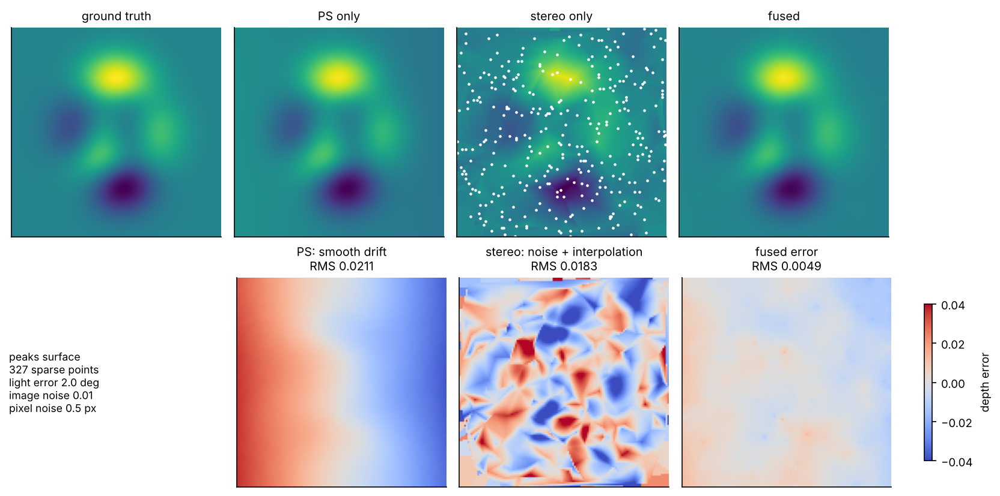
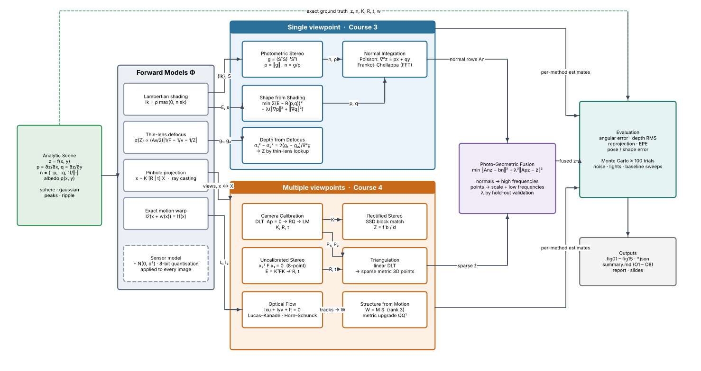
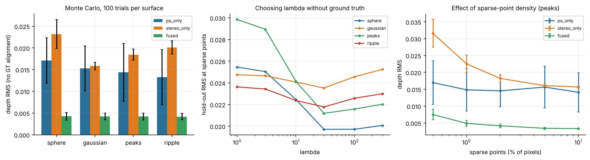

# Photo-Geometric 3D Shape Recovery as an Inverse Imaging Problem

A from-scratch Python study of 3D shape recovery from images. Every image is computed from a known
physical model of how a camera forms an image, so every reconstruction is checked against the exact
true shape. The project needs no hardware and no datasets.


*Peaks surface: ground truth, photometric stereo only, stereo only, and the fused reconstruction (top), with their depth errors (bottom).*

---

## Contents

- [Context](#context)
- [Problem statement](#problem-statement)
- [Objectives](#objectives)
- [Methodology](#methodology)
- [Key results](#key-results)
- [Main finding](#main-finding)
- [Getting started](#getting-started)
- [Repository layout](#repository-layout)
- [Conventions](#conventions)
- [Limitations](#limitations)
- [Documentation](#documentation)
- [References](#references)

---

## Context

This is the capstone project for two courses of the *First Principles of Computer Vision*
specialization (Columbia University, Coursera, Prof. Shree Nayar):

- **3D Reconstruction – Single Viewpoint**: radiometry and reflectance, photometric stereo, shape from shading, depth from defocus
- **3D Reconstruction – Multiple Viewpoints**: camera calibration, uncalibrated stereo, optical flow, structure from motion

The project treats every method in these courses as an **inverse problem**. A camera maps a 3D scene to
an image through a forward model (projection, shading, blur). Reconstruction tries to invert that model
from noisy and incomplete measurements. Because the forward model here is written explicitly, the true
answer is always known, and every error can be measured exactly and traced to its cause.

## Problem statement

The two families of methods in the courses recover shape in complementary ways:

- **Photometric methods** (single viewpoint) recover a surface normal at every pixel. Integrating the
  normals gives depth, but only up to a constant, and small consistent errors in the normals add up to a
  smooth drift in depth.
- **Geometric methods** (multiple viewpoints) recover true metric depth, but only at the points that
  can be matched between views, and each point carries random noise.

The project asks three questions:

1. How accurate is each method, and how does image noise spread into 3D error?
2. Where and why does each method fail, when measured against exact ground truth?
3. Can dense photometric normals and sparse metric points be combined into a reconstruction that is
   more accurate than either one alone?

## Objectives

| # | Objective | Status |
|---|---|---|
| O1 | Render images of analytic surfaces from a closed-form forward model | Done (error 4.4 × 10⁻¹⁶) |
| O2 | Recover normals and albedo by photometric stereo; integrate to depth | Done |
| O3 | Implement shape from shading and depth from defocus; compare with photometric stereo | Done |
| O4 | Calibrate a virtual camera (DLT, RQ decomposition, nonlinear refinement) | Done |
| O5 | Reconstruct 3D points by rectified and uncalibrated stereo | Done |
| O6 | Estimate optical flow; recover shape and motion by factorisation | Done |
| O7 | Fuse photometric normals with triangulated points | Done (beats both inputs on 4/4 surfaces) |
| O8 | Regenerate every figure and number with one command | Done |

## Methodology

Every module follows the same loop:

```
analytic scene  ─►  forward model  ─►  synthetic images (+ noise)  ─►  inverse method  ─►  estimate
      │                                                                                     │
      └──────────────────────────── exact ground truth ──────────────────────► error metrics
```



### 1. Scenes and forward models

- **Scenes:** four height fields z = f(x, y) (sphere cap, Gaussian bump, "peaks", sinusoidal ripple) with
  derivatives written by hand, so depth and normals are exact.
- **Forward models:** Lambertian shading, thin-lens defocus, pinhole projection with ray casting, and
  image pairs with an exactly known motion field.
- **Sensor model:** Gaussian noise and optional 8-bit quantisation. Light directions can be deliberately
  mis-calibrated to model real errors.

### 2. Single-viewpoint methods

| Method | Idea | Implementation |
|---|---|---|
| Photometric stereo | Brightness under ≥ 3 known lights fixes the normal | Per-pixel weighted least squares with shadow masking |
| Normal integration | Depth from slopes | Sparse Poisson least squares; Frankot–Chellappa (FFT) |
| Shape from shading | Shape from a single shaded image | Variational method with smoothness regularisation |
| Depth from defocus | Relative blur between two focus settings gives depth | Spatial-domain S-transform, thin-lens lookup |

### 3. Multiple-viewpoint methods

| Method | Idea | Implementation |
|---|---|---|
| Camera calibration | Recover K, R, t from a known 3D target | Normalised DLT → RQ decomposition → Levenberg–Marquardt |
| Rectified stereo | Depth from horizontal shift, Z = f b / d | SSD block matching with sub-pixel parabola fit |
| Uncalibrated stereo | Two-view geometry, x₂ᵀ F x₁ = 0 | Normalised 8-point algorithm, essential matrix, triangulation |
| Optical flow | Brightness constancy, I_x u + I_y v + I_t = 0 | Lucas–Kanade and Horn–Schunck, coarse-to-fine with warping |
| Structure from motion | Tracked points form a rank-3 matrix | Tomasi–Kanade factorisation with metric upgrade |

### 4. Photo-geometric fusion

Depth z on the photometric grid is found by solving one sparse least-squares problem:

```
min_z  ‖A_n z − b_n‖²  +  λ² ‖A_p z − ẑ‖²
```

- **Normal rows (A_n):** each pair of neighbouring pixels must be consistent with the measured normal.
  These rows supply fine detail.
- **Position rows (A_p):** pixels with a triangulated stereo point must match its height. These rows fix
  scale, offset and slow trends.
- **λ** is chosen by hold-out validation on the stereo points, without using ground truth.

### 5. Evaluation

- Exact errors against ground truth: angular error, depth RMS, reprojection error, flow endpoint error,
  pose and shape error after similarity alignment.
- **Monte Carlo:** 100 trials per setting with fresh noise, reported as mean ± standard deviation.
- **Unit tests:** with no noise, every method must recover the true answer.

## Key results

All numbers come from `python -m experiments.run_all` (100 trials, fixed seeds).

**Fusion (depth RMS, no ground-truth alignment)**

| Surface | Photometric stereo only | Stereo only | Fused | Fused best in |
|---|---|---|---|---|
| sphere | 0.0171 ± 0.0052 | 0.0232 ± 0.0033 | **0.0043 ± 0.0008** | 100 % of trials |
| gaussian | 0.0153 ± 0.0052 | 0.0158 ± 0.0009 | **0.0042 ± 0.0008** | 100 % |
| peaks | 0.0144 ± 0.0067 | 0.0185 ± 0.0013 | **0.0042 ± 0.0008** | 99 % |
| ripple | 0.0133 ± 0.0064 | 0.0201 ± 0.0015 | **0.0042 ± 0.0007** | 94 % |

Setup: 4 lights, image noise 0.01, light directions off by 2°, stereo points at 2 % of pixels with
0.5 px noise. Fusion lowers depth error 3–4 times compared with the better single source.

**Individual methods**

| Method | Result |
|---|---|
| Photometric stereo, noise-free | 2.4 × 10⁻⁷ ° mean normal error |
| Photometric stereo noise vs. theory | Measured spread matches σ²(SᵀS)⁻¹ within 0.4 % |
| Calibration, 0.5 px noise | Focal length within 0.47 %; reprojection 0.692 px (theoretical floor 0.694 px) |
| Uncalibrated stereo, 0.5 px noise | 0.39° rotation error; points within 0.6 % of depth range |
| Optical flow (motions up to 2.2 px) | Worst endpoint error 0.024 px |
| Structure from motion, 20 frames | Exact without noise; 0.79 % shape error with tracking noise 0.005 |
| Shape from shading | 1.5° on the sphere; 9–15° on other surfaces (single-image ambiguity) |
| Depth from defocus, noise-free | 5–25 mm RMS over a 500–1000 mm range |



## Main finding

Fusion works because the two sources make different kinds of error. Photometric stereo drifts smoothly;
stereo is noisy but unbiased. However, **the best fusion weight λ depends on conditions the data do not
reveal.** With lights off by 2°, validation picks λ ≈ 10–100 (mostly 30). With exactly calibrated lights it picks
λ ≈ 1–10, and photometric stereo alone is already as good as the fused result (≈ 0.001). Hold-out
validation follows this change only roughly (λ ranges from 1 to 100 across trials), uses a fifth of the
stereo points, and gives no measure of confidence.

This points to an open question: choosing such weights automatically, from a model of the sensor and
its errors, instead of tuning them.

## Getting started

**Requirements:** Python 3.10+, NumPy, SciPy, Matplotlib, pytest.

```bash
git clone <repository-url>
cd <repository-folder>
python -m venv .venv
source .venv/bin/activate          # Windows: .venv\Scripts\activate
pip install -r requirements.txt
```

**Run the tests** (23 tests, about 2 s):

```bash
python -m pytest -q
```

**Reproduce all results:**

```bash
python -m experiments.run_all --quick   # 10 trials, about 1 min
python -m experiments.run_all           # 100 trials, about 2–3 min
```

**Run one study:**

```bash
python -m experiments.exp_single_view --trials 20
python -m experiments.exp_multi_view --trials 20
python -m experiments.exp_fusion --trials 20
```

**Use a module directly:**

```python
from capstone.scenes import make_scene, pq_from_normals
from capstone.render import light_ring, render_stack, add_noise
from capstone.photometric.ps import photometric_stereo
from capstone.photometric.integrate import poisson_integrate
from capstone.metrics import angular_error_deg, depth_rms
import numpy as np

rng = np.random.default_rng(0)
scene = make_scene("peaks")                        # exact depth and normals
S = light_ring(4)                                  # 4 light directions
I = add_noise(render_stack(scene.n, scene.albedo, S), 0.01, rng)

n, albedo, valid = photometric_stereo(I, S)        # invert shading
z = poisson_integrate(*pq_from_normals(n), scene.dx)

print(angular_error_deg(n, scene.n, valid), depth_rms(z, scene.z))
```

Results are written to `results/`: 15 figures, three JSON files with every number, and `summary.md`
with all objective checks.

## Repository layout

```
capstone/
├── scenes.py              analytic surfaces, normals, procedural texture
├── render.py              forward models: shading, noise, defocus, ray casting, motion
├── metrics.py             error measures and similarity alignment
├── fusion.py              photo-geometric fusion and λ selection
├── photometric/
│   ├── ps.py              photometric stereo
│   ├── integrate.py       Poisson and Frankot–Chellappa integration
│   ├── sfs.py             shape from shading
│   └── dfd.py             depth from defocus
└── geometric/
    ├── camera.py          pinhole camera model
    ├── calib.py           camera calibration
    ├── stereo.py          rectified stereo
    ├── epipolar.py        8-point algorithm, pose, triangulation
    ├── flow.py            Lucas–Kanade and Horn–Schunck
    └── sfm.py             Tomasi–Kanade factorisation
experiments/               Monte Carlo studies, figures, objective checks
tests/                     noise-free unit tests
results/                   generated figures, JSON results, summary.md
docs/                      data-flow diagram (draw.io) and reference manual
```

## Conventions

- Grid arrays use rows = y and columns = x on [−1, 1]²; p = ∂z/∂x, q = ∂z/∂y, n = (−p, −q, 1)/‖·‖.
- Photometric methods assume an orthographic camera looking along +z.
- Cameras follow x ~ K [R | t] X with X_cam = R X + t (OpenCV convention).
- All solvers are written in NumPy/SciPy. OpenCV is used only for optional cross-checks.
- Every random number comes from a seeded generator, so results are repeatable.

## Limitations

- Scenes are smooth height fields: no occlusions, cast shadows or inter-reflections.
- Reflectance is Lambertian in the main pipeline (a Blinn–Phong renderer is included for testing).
- Shape from shading uses known boundary gradients.
- Two-view geometry becomes unreliable when points are close to a single plane (see `fig11`).
- Structure from motion uses an orthographic camera model.
- Real images have not been tested; this is a controlled synthetic study.

## Documentation

- `docs/pipeline.drawio`: data-flow diagram (open at [app.diagrams.net](https://app.diagrams.net)).
- `docs/Reference_Manual.pdf`: a 46-page guide covering the background maths, every module with its
  code, and all results.
- `results/summary.md`: objective checks and result tables from the latest run.

## References

- S. K. Nayar, *First Principles of Computer Vision*, Columbia University.
- R. J. Woodham, "Photometric method for determining surface orientation from multiple images," *Optical Engineering*, 1980.
- R. T. Frankot and R. Chellappa, "A method for enforcing integrability in shape from shading algorithms," *IEEE TPAMI*, 1988.
- M. Subbarao and G. Surya, "Depth from defocus: a spatial domain approach," *IJCV*, 1994.
- R. Hartley and A. Zisserman, *Multiple View Geometry in Computer Vision*, 2nd ed., 2004.
- R. I. Hartley, "In defense of the eight-point algorithm," *IEEE TPAMI*, 1997.
- B. D. Lucas and T. Kanade, "An iterative image registration technique with an application to stereo vision," *IJCAI*, 1981.
- B. K. P. Horn and B. G. Schunck, "Determining optical flow," *Artificial Intelligence*, 1981.
- C. Tomasi and T. Kanade, "Shape and motion from image streams under orthography: a factorization method," *IJCV*, 1992.
- D. Nehab, S. Rusinkiewicz, J. Davis and R. Ramamoorthi, "Efficiently combining positions and normals for precise 3D geometry," *ACM TOG*, 2005.

## Author

Muhammad Areeb Iqbal, BS Electrical Engineering (Electronics), PIEAS.
